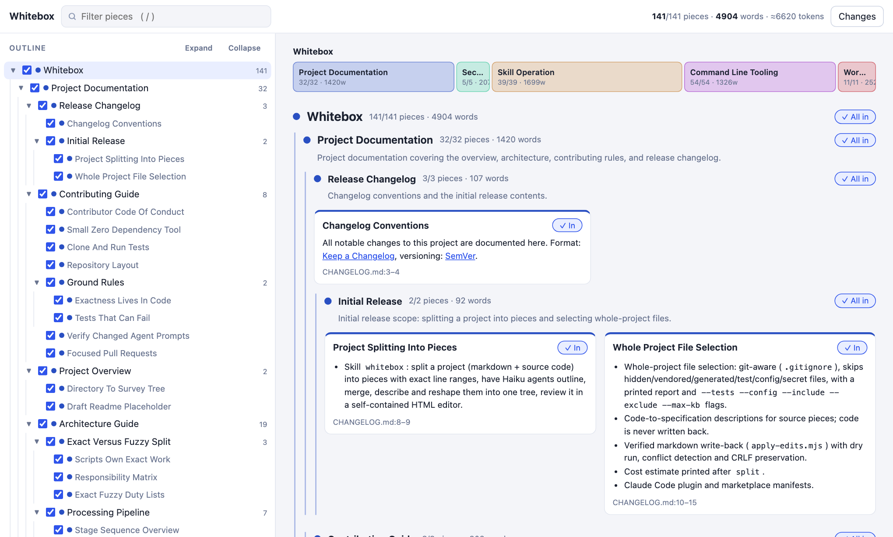
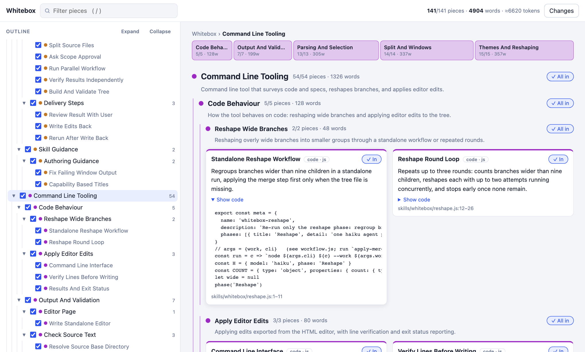

# whitebox

**Make a project's insides visible.** whitebox is a [Claude Code](https://claude.com/claude-code) skill that turns a codebase
or a pile of specs into **one overseeable tree** of small pieces with plain-language titles and descriptions, and lets you
review it in an interactive HTML editor: include or exclude branches, edit pieces, export a compact context pack, and write
markdown edits back to the files.



Big specs and unfamiliar repositories are black boxes: too much to read, no map. whitebox gives you the map.

- **Docs become a tree.** Every markdown file is cut into pieces (list items, tables, paragraphs, ...) that keep their exact
  `file:start-end` line ranges and are grouped by meaning, not by file layout.
- **Code becomes specification.** Each source piece is inverted into a requirement-style description (*what* the system does or
  guarantees), grouped by capability. You read "Reject expired tokens", not `func validate()`. The code is one click away.
- **You stay in control.** Include or exclude any branch, edit any piece, then export a context pack for another LLM, or write
  your markdown edits back, verified against the original text. Source code is never rewritten.



## Try it without installing anything
This repository was run through whitebox on itself. Clone it and open
[`examples/dogfood/whitebox.html`](examples/dogfood/whitebox.html) in a browser: it is a self-contained snapshot of the editor
(141 pieces from this repo's docs and scripts). Press `/` to filter, click a card to edit, open the **Changes** drawer.

## Install
As a Claude Code plugin:
```text
/plugin marketplace add oleksiyp/whitebox
/plugin install whitebox@whitebox
```
or copy the skill folder yourself (project-level `.claude/skills/` or global `~/.claude/skills/`):
```sh
git clone https://github.com/oleksiyp/whitebox
cp -r whitebox/skills/whitebox ~/.claude/skills/whitebox
```
Requirements: Node >= 18 (no npm packages), git (optional, for `.gitignore`-aware selection), and Claude Code with the
Workflow tool (a manual fallback using plain subagents is documented in
[`references/troubleshooting.md`](skills/whitebox/references/troubleshooting.md)).

## Use
In Claude Code, from the directory where scratch files may live (not inside the analysed repo):
```text
/whitebox ~/dev/some-project
```
or just say "map this repo", "what is in these specs?", "turn this code back into requirements". The skill then:

1. **splits** the project (seconds, no LLM) and shows you what it selected and what it skipped, with a cost estimate;
2. **asks you** to confirm scope and cost (tests? config? something sensitive?) before spending anything;
3. runs the **Haiku workflow** (outline, verify, merge, describe, reshape) in the background;
4. **verifies** the result with scripts, builds `whitebox.json` / `whitebox.html`, and opens the editor;
5. on request, **writes your markdown edits back** after a dry run you approve.

## What gets analysed
In a git repository: tracked and untracked files, honouring `.gitignore`. On top of that it skips hidden files, `node_modules`,
`vendor`, `dist`, `build`, fixtures, lockfiles, minified files, binaries, generated code (`Code generated`, `DO NOT EDIT`),
files that look like secrets (`.env*`, `*.pem`, `*.tfstate`, ...), and, by default, tests and config files. Everything skipped is
printed with counts and examples; `--tests`, `--config`, `--include`, `--exclude`, `--max-kb` change it.
Details: [`references/selection.md`](skills/whitebox/references/selection.md).

## How it works, in one paragraph
Scripts do everything that must be exact (file selection, cutting into pieces, line ranges, verbatim text, validation,
write-back); cheap Haiku agents only write titles, groupings and descriptions, and every agent output is checked by a script the
agent runs until it prints `OK`. Agents never see line numbers and never write source text, so the tree cannot corrupt your files.
See [`docs/architecture.md`](docs/architecture.md).

## Cost, honestly
A Haiku agent costs roughly 40-85k tokens whatever its job, so cost is about *number of agents x 0.06M tokens*; `split` prints the
estimate. Two real runs: a 153-file markdown spec (14,200 pieces) took about 10M tokens and 25 minutes; a 444-file Go and
TypeScript project (4,800 pieces, 4,300 of them code) about 7M tokens and 21 minutes. Estimates are good to about 0.5x-2x.
Small projects (a few dozen files) cost a fraction of a million tokens and a few minutes.

## Privacy
**The text of every selected file is sent to the model provider** by the subagents, exactly as if you had asked Claude Code to read
it. The skill makes you confirm the selection first. Secret-looking files are skipped, but that is a heuristic: a secret pasted into
a source file is not detected. Work files and generated pages contain verbatim excerpts, so do not commit them for private projects.
See [`SECURITY.md`](SECURITY.md).

## Limitations
- **Not incremental.** After you change the source (or write edits back) the line ranges are stale; `build` detects it and you re-run.
- **Titles and descriptions are model-written** and only spot-checked. The verbatim text is always exact; the labels are not.
- **Code write-back does not exist by design.** Editing a description on a code piece records a *behaviour change note*, a work list for you
  or a coding agent, never a source edit.
- The code cutter is a heuristic (bracket depth and column-0 starts), not a parser; a wrong cut can only split a function between two
  pieces, it cannot lose text.
- Quality of the grouping depends on the Haiku model; if merge or reshape look poor the skill offers to redo that phase with a stronger one.

## Repository layout
```text
skills/whitebox/      the skill: SKILL.md, workflow.js, reshape.js, scripts/, references/
.claude-plugin/       plugin and marketplace manifests
test/                 node:test suites (npm test), fixtures are generated in temp dirs
docs/                 architecture notes and screenshots
examples/dogfood/     whitebox run on its own repository (open whitebox.html)
```

## Development
```sh
npm test    # 27 tests: segmenter, file selection, the whole pipeline with a fake agent, write-back safety
```
See [`CONTRIBUTING.md`](CONTRIBUTING.md). Issues and ideas welcome.

## License
[MIT](LICENSE)
